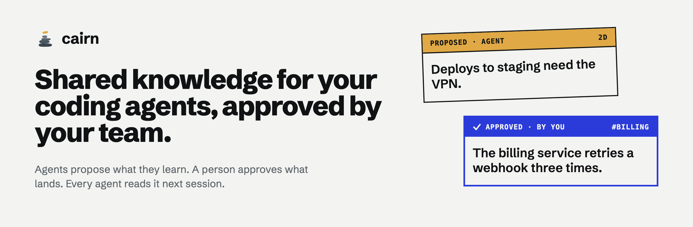

<p align="center">
  <a href="https://cairn-kb.dev">
    <picture>
      <source media="(prefers-color-scheme: dark)" srcset="assets/banner-dark.png">
      
    </picture>
  </a>
</p>

# cairn — shared knowledge for your coding agents, approved by your team

Agents read shared team knowledge and propose additions. A human approves what
lands. Nothing an agent proposes is visible to other agents until it is
approved. Knowledge is stored as *claims*: one assertive sentence a reviewer
can judge, a body explaining it, and a short abstract an agent reads first.

cairn is a single Bun-compiled binary: a local-first CLI, and an MCP server
your agents talk to. The same binary is also the client for an optional
hosted team space, for when more than one person needs to share a queue.

## Install

```bash
curl -fsSL https://raw.githubusercontent.com/cairn-kb/cairn/main/install.sh | sh
cairn init                               # choose local or team, connect the agents on this machine
cairn doctor                             # confirm it actually works
```

Prebuilt for macOS (arm64, x64) and Linux x64 (glibc; not musl/Alpine). The
install line works from the first public release on. Elsewhere, run from
source with Bun (see [CONTRIBUTING.md](CONTRIBUTING.md)). `CAIRN_VERSION`
pins a release tag (for example `CAIRN_VERSION=v1.2.3`, any tag on the
releases page), and `CAIRN_INSTALL_DIR` picks where the binary goes
(`~/.local/bin` by default).

`cairn init --local` needs no account. With no Claude Code, Cursor, Codex
or Claude Desktop installed, add `--project` to write `.mcp.json` anyway. `cairn init --team`
(or choosing the shared team space at the prompt) needs an account first —
the hosted tier is an invite-only beta, see [Free and hosted](#free-and-hosted):

```bash
cairn login                              # opens a browser, stores a token
```

`cairn login` opens your browser, asks you to approve this machine, and stores
the token in `$CAIRN_ROOT/config.json` (`~/.cairn` by default) at mode `0600`.
Over SSH, `cairn login --no-browser` prints a URL to open elsewhere and takes
the code by hand. If the browser cannot get back to the terminal, the code is
in its address bar and cairn asks for it rather than throwing the login away.
`cairn logout` revokes this machine's token.

## First run

```bash
cairn import ~/code/acme/docs   # reads .md files only
cairn review                    # review the queue in this terminal
```

`cairn import` walks `.md` files, nothing else. If your material is PDFs,
slide decks, or anything else, convert it first and import the output:

```bash
mineru -p paper.pdf -o /tmp/seed -b pipeline && cairn import /tmp/seed
```

`pandoc` and `markitdown` work too — anything that writes markdown. No
converter ships with cairn itself: converters are far heavier than a CLI
installed with one `curl | sh`, so conversion stays a pre-step you run once.

Imported documents are searchable and readable by agents right away, but they
are not in `team_knowledge_map` — nobody reviewed them, so they earn no place
in a map of what the team has approved. An agent that reads one and learns
something from it proposes a claim citing the document, and that claim goes
through review like anything else an agent proposes.

`cairn review` opens a full-screen reader: one pending claim at a time, its
body rendered as markdown and wrapped to your terminal, scrolling with the
arrow keys while the claim sentence and the decision keys stay on screen.
Press `e` to edit the sentence, body and abstract in place — Tab between
fields, Esc to finish. From there, `E` hands off to `$VISUAL`/`$EDITOR` and
returns you to the screen when you're done. Below 120 columns, `o` toggles a
references pane into view when a claim overlaps something already approved
or cites a document; at 120 columns and above the pane is always there
alongside the claim, whether or not it has anything to show. An edit counts
as an approval and is reported separately, so `edited` never hides inside
`approved`.

`cairn review --json` prints the pending queue for a script. It is the only
non-interactive way in — the interactive command refuses without a terminal
rather than exiting 0 having reviewed nothing.

`cairn retract <id> --reason <text>` withdraws an approval that turned out to
be wrong. Only a human runs this — there is no MCP tool for it, the same way
there is no MCP tool for `review` — and the reason is required: a retraction
with no stated grounds is a decision nobody can reconstruct later. The claim
stays in the space, marked retracted: `cairn search --all` still finds it, and
`team_knowledge_read` returns a retraction notice with the reason in place of
the claim. It drops
out of `team_knowledge_map` and out of a plain `cairn search`, the same way a
rejected claim never appeared there.

`cairn cite <id> <doc-id> --supports <text>` attaches a citation to a claim
after the fact, recording what the document is claimed to support, its
content hash, and which words of the claim do not appear in it at all. Agents
can do the same through `team_knowledge_cite`. `cairn uncite <id> <doc-id>`
detaches one — like `retract`, human-only, with no MCP equivalent: an agent
attaches evidence, but only a person decides a citation no longer belongs.

### No model, no key by default

cairn holds no provider key and reaches no provider until you run `cairn model`
and choose one; pointing that at Ollama keeps every request on your own
machine. The abstract an agent reads to decide whether to open a claim is
written by the **proposing agent**, which already has the whole session as
context and is a better writer than any small local model we could ask you to
install. It arrives with the claim and a reviewer can sharpen it while
approving.

## Connect an agent

```bash
cairn init
```

That is the setup. On a fresh root, `init` asks whether to configure this
project or your whole machine and finds which agents you have installed. It
shows what it will write: their MCP config, with the correct absolute path
resolved from itself, and the instructions block that tells an agent to
consult knowledge at session start. Then it asks where knowledge should live —
local or team, see below.

In a terminal, `init` keeps going once the files are written. It starts each
agent's cairn entry exactly as written to prove the agent can run it, and says
what it cannot check — Cursor's project approval, and that a running agent
needs a restart. It offers to import the repository's docs (README, `docs/`,
ADRs and other `.md` files outside dependency and build folders), lets you
drop folders or add more, and runs one search over them to show a first
answer. With fewer than three docs in a local space it imports what there is
and also installs a `cairn-import` skill so your agents can map the code —
`.claude/skills/cairn-import/SKILL.md` for Claude Code (`~/.claude/skills/...`
with `--global`), `.cursor/rules/cairn-import.mdc` for Cursor at project
scope, and `~/.agents/skills/cairn-import/SKILL.md` for Codex — then tells you
what to say, `map this repo for cairn`, offering to start Claude Code with it.
Choosing a team space signs you in first and confirms before importing
anything your team will see. Every write is previewed and confirmed first. In
a terminal, project scope means the git repository you are in, wherever inside
it you run `init`.

Pass `--local` or `--team` to skip the mode question, and `--project` or
`--global` to skip the scope one — scripted onboarding needs both, plus
`--yes` to skip every prompt and `--no-telemetry` (or `--telemetry`) to answer
the consent question. A non-interactive run defaults to project scope rather
than silently editing files in your home directory. `--dry-run` shows every
file it would touch and what it would import. Re-running `init` with neither flag leaves an existing
root's mode alone. `--local` or `--team` on an existing root switches it only
when nothing would be stranded: a team root holding claims refuses to go
local, and a local root holding anything goes through the migration below.

| | Project (default) | Global |
|---|---|---|
| Claude Code | `.mcp.json` | `~/.claude.json` |
| Cursor | `.cursor/mcp.json` + `.cursor/rules/cairn.mdc` | `~/.cursor/mcp.json`, rules printed |
| Codex | `~/.codex/config.toml`, in a terminal only | `~/.codex/config.toml` + `~/.codex/AGENTS.md` |
| Claude Desktop | its `claude_desktop_config.json`, rules printed, in a terminal only | its `claude_desktop_config.json`, rules printed |
| Instructions | `AGENTS.md`, or your existing `CLAUDE.md` | `~/.claude/CLAUDE.md` |

**Instructions go in one file, never two.** An existing `AGENTS.md` wins, an
existing `CLAUDE.md` is honoured rather than orphaned, and a repo with neither
gets `AGENTS.md` — the cross-tool convention that Copilot and others read.

**Project scope adds the MCP configs to `.gitignore`**, because they contain an
absolute path that is wrong on every other machine. Committing them would hand
teammates a broken config, which is worse than no config: each person runs
`init` themselves.

Cursor's *user-level* rules live in its settings rather than a file, so global
scope prints that block for you to paste. Project-level Cursor rules are a real
file and get written.

Codex and Claude Desktop each keep one config for the whole machine, so `init`
writes theirs only when you run it in a terminal (at either scope) or pass
`--global`. A `--yes` or scripted project-scope run leaves them alone and
says so in one line. Codex reads a project's `AGENTS.md` itself; when
the project uses `CLAUDE.md` instead, the rules also go in `~/.codex/AGENTS.md`.
Claude Desktop has no instructions file — paste the printed block into a Claude
project — and only loads a new server after you quit it completely and reopen it.

`init` never clobbers. Existing MCP servers are preserved, the instructions sit
between `<!-- cairn:start -->` sentinels so re-running updates in place, and a
config file it cannot parse aborts the run rather than being overwritten. The
one exception is a Codex or Claude Desktop config cairn can't safely edit: that
agent is skipped, the file is left as it is, and `init` prints the cairn entry
for you to add by hand while it configures the rest.

Restart the agent afterwards so it picks up the new MCP server.

**Any other MCP client** can run the same server. Point it at the binary with
`mcp` as the argument, and set `CAIRN_ROOT` explicitly — the agent does not
inherit your shell, so the root must be written into its config as an
absolute path:

```json
{ "command": "/absolute/path/to/cairn", "args": ["mcp"], "env": { "CAIRN_ROOT": "/Users/you/.cairn" } }
```

### What agents can call

| Tool | What it does |
|---|---|
| `team_knowledge_map` | the approved claims, by abstract — called at session start |
| `team_knowledge_search` | search approved claims and imported documents |
| `team_knowledge_read` | read claims or documents in full |
| `team_knowledge_propose` | propose a claim, optionally citing documents; it waits for review |
| `team_knowledge_cite` | attach a document to an existing claim as evidence |
| `team_knowledge_write_document` | write a generated overview document into a local space |

There is no tool to review, retract or uncite: those are a person's.
`team_knowledge_write_document` is refused in team mode — writing a
generated document into a space backed by the hosted service isn't
supported yet; import it yourself in the console instead.

## Filling in the missing abstracts

Claims that arrived without an abstract can have one generated. Choosing the
model is a menu, not a name you have to already know:

```bash
cairn model      # pick a provider, pick from the models it is serving
cairn abstracts  # write the abstracts that are missing
```

`cairn model` lists what the provider is actually serving, generates one real
abstract from your smallest claim that has none, and saves the choice only if
you accept what came back. It writes nothing to the store and logs no event, so
it is safe to run repeatedly while comparing models.

| | |
|---|---|
| `--provider X --model Y` | set it without prompting; `X` is `anthropic`, `openai` or `compatible` |
| `--list` | print the models the configured provider is serving |
| `--verify` | with the flags above, generate one abstract before saving |
| `--base-url URL` | any OpenAI-compatible endpoint — LM Studio, vLLM, OpenRouter |

Three providers: **Anthropic** (`anthropic`), **OpenAI** (`openai`), and
**any OpenAI-compatible endpoint** (`compatible`), which defaults to Ollama on `http://127.0.0.1:11434/v1` and needs no
key. Nothing is sent anywhere until this is configured.

**Keys resolve environment → stored**: `CAIRN_MODEL_KEY` first, then
`ANTHROPIC_API_KEY` or `OPENAI_API_KEY` for their own providers, then the key
saved in `config.json`. A key you export always beats one cairn saved earlier,
and rotating a key means exporting the new one. A key typed at the prompt is
stored in `config.json` at mode `0600`; one that came from the environment is
never written to disk.
`CAIRN_MODEL` and `CAIRN_MODEL_URL` override the stored model and endpoint,
`--max-tokens N` (or `CAIRN_MODEL_MAX_TOKENS`) caps an abstract's length, and
`cairn doctor` reports the model that will actually be used, never the key.
`cairn abstracts --dry-run` shows what it would write without saving it — it
still calls the model for every claim, so it spends tokens, and it needs a
model configured. **`--all` regenerates every machine-written abstract**, not
just the missing ones, and marks every one of them generated — but it leaves
alone an abstract an agent wrote, a person wrote in `cairn curate`, or one
with no recorded provenance (an older claim, written before cairn tracked
who wrote an abstract) — unknown provenance may be a person's writing too.
Add `--force` to regenerate those as well.

Generated abstracts are marked as generated and nobody has reviewed them —
`cairn status` says how many, and `cairn curate` is where you clear them:

```bash
cairn curate     # walk the machine-written abstracts and give them your words
```

## Local, or a shared team space

`cairn init` asks where knowledge should live: **on this machine only** — no
account, no network — or **in your team's shared space** on cairn's hosted
service. In a non-interactive shell (or with `--yes`), `cairn init` with
neither flag picks **team** mode, which then needs `cairn login`; use
`cairn init --local` there for a local space.

Team mode is the one that needs an account and a network: every command that
reads or writes team knowledge — and the MCP server your agent spawns — exits
1 with `cairn login` if this machine is not connected. That is deliberate. A
claim written to one laptop is a claim no teammate and no other agent will
ever see, and the failure it produces should be an error, not silence.

**Moving from local to team.** `cairn init --team` on a local root migrates
what's there: approved claims arrive approved, pending ones arrive pending,
and anything you rejected stays behind rather than being resurrected. The
move is one-way and lossy — the hosted store assigns its own ids and
timestamps, so who proposed each claim and when does not transfer — which is
why `cairn init --team` refuses to run it non-interactively: that's a call
only the person at the keyboard gets to make. If there's anything to move, it
needs an account connected first — `cairn login`, then `cairn init --team`
again.

`cairn login` refuses in a local space only if you're already signed in and
holding a token nothing reads; with no account it proceeds, since signing in
is the prerequisite for moving to a team space and refusing outright would
strand you. `cairn logout` in a local space only clears a token left over from
an earlier sign-in; with no account it refuses.

**A shared `CAIRN_ROOT` is not supported.** A local space is a directory:
claim files by status (`inbox/`, `approved/` and so on), `documents/`, an
append-only `events.jsonl`, a SQLite `index.db`, and `config.json`, which
holds your sign-in token if you have one. Pointing more than one machine or
person at the same directory — a synced folder, a shared drive, checking it
into git — will corrupt it: the event log conflicts the moment two writers
append to it, and `index.db` must never be committed. cairn does not stop you.
Teams are what the hosted space is for.

In a team space, `cairn org list` shows the spaces your account belongs to and
`cairn org use <slug>` points this machine at another one. `cairn review
--mine` narrows the queue to claims whose tags you own. `CAIRN_API_URL`
points the CLI at a different service endpoint.

## Free and hosted

| Open (free) | Hosted (cairn team spaces) |
|---|---|
| Local spaces: `init --local`, review TUI, event log, `stats` | Shared team spaces: hosted store and sync |
| MCP server for any agent | Web console for reviewers who never open a terminal |
| `model`, `abstracts`, `curate` with your own provider keys | Orgs, invites, roles, tag-ownership routing |
| `import`, `doctor`, `rebuild` | Browser sign-in for each machine |
| Team-mode client, `@cairn-kb/protocol` | Approve-rate and queue stats for the whole team |

Local mode is complete and free — nothing in the left column moves to the
right one later.

**The hosted tier is an invite-only beta.** To request access, email
0xQwertic@proton.me. Once you have an account, `cairn login` signs this
machine in through your browser, and `cairn init --team` moves it to a team
space, migrating a local root's claims across as described above.

## Telemetry

With consent, cairn sends at most one ping a day: an install id (not tied to
you), the cairn version and platform, and counts — proposed, approved,
rejected, reads, sessions, the age in days of the oldest pending claim, and
how many abstracts are machine-generated. It also reports, once, how long it
took from finishing `cairn init` to your agent's first search that found
something, as one of a small set of buckets (`<5m`, `5–10m`, `10–30m`,
`>30m`, `never`) rather than a raw duration. Nothing is sent before you say yes —
the consent screen at `cairn init` shows an example of the exact JSON first
(`--telemetry` and `cairn telemetry on` consent without it) — and nothing it
sends can identify a claim, a document, or what either one says. Pings go to
`telemetry.cairn-kb.dev` with a fixed `x-cairn-key` header that every binary
carries. In a team space the counts are the shared space's totals, not this
machine's. While telemetry is on, `cairn doctor` also checks that
`telemetry.cairn-kb.dev` is reachable.

Turn it off any time:

- answer no when `cairn init` asks, or pass `cairn init --no-telemetry`;
- `cairn telemetry off` (and `cairn telemetry status` to check your recorded
  answer — it does not reflect the two variables below);
- `CAIRN_TELEMETRY=0` (exactly `0`);
- `DO_NOT_TRACK` set to anything but empty, `0` or `false` (in any case) — the
  cross-tool convention.

## Commands

| | |
|---|---|
| `cairn init` | connect your agents; choose local or team |
| `cairn doctor [--json]` | check that it actually works |
| `cairn import <dir>` | add a directory of `.md` files as documents |
| `cairn review [--json] [--mine]` | walk the pending queue |
| `cairn status` / `cairn stats` | the queue, reads and missing abstracts / the raw counts as JSON |
| `cairn search <text> [--all] [--json]` | find what the team knows |
| `cairn show <id> [--json]` | one claim or document in full |
| `cairn retract <id> --reason <text>` | withdraw an approved claim |
| `cairn cite` / `cairn uncite` | attach or detach a document as evidence |
| `cairn model`, `cairn abstracts`, `cairn curate` | generate abstracts and review them |
| `cairn adopt-imports` | convert claims an older `cairn import` wrote into documents |
| `cairn rebuild` | reindex a local space |
| `cairn login [--no-browser]` / `cairn logout` | sign in and out |
| `cairn org [list\|use <slug>]` | see or change which team space this machine uses |
| `cairn telemetry [status\|on\|off]` | consent to the daily counts |
| `cairn mcp` | the MCP server an agent runs; `init` configures it for you |
| `cairn --version` | print the version, commit and build date |

`cairn --help` lists every flag.

## License

Apache-2.0 — see [LICENSE](LICENSE) and [NOTICE](NOTICE). The cairn name and
logos are not covered by that license; see [TRADEMARKS.md](TRADEMARKS.md).
Contributions are welcome — see [CONTRIBUTING.md](CONTRIBUTING.md) and the
[Code of Conduct](CODE_OF_CONDUCT.md). Report vulnerabilities privately, as
[SECURITY.md](SECURITY.md) describes.
